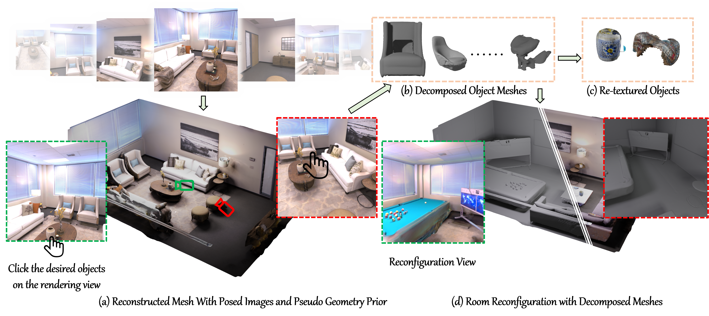

<p align="center">
  <h1 align="center">Total-Decom: Decomposed 3D Scene Reconstruction with Minimal Interaction</h1>
  <p align="center">
    <a href="http://shawlyu.github.io/">Xiaoyang Lyu*</a> ·
    Chirui Chang* ·
    <a href="https://daipengwa.github.io/">Peng Dai</a> ·
    <a href="https://sunyangtian.github.io/">Yang-Tian Sun</a> ·
    <a href="https://xjqi.github.io/">Xiaojuan Qi</a>
  </p>
  <p align="center"><sup>*</sup>Equal contribution</p>
  <h3 align="center">CVPR 2024</h3>
  <h3 align="center">
    <a href="https://arxiv.org/abs/2403.19314">Paper</a> |
    <a href="https://cvmi-lab.github.io/Total-Decom/">Project Page</a>
  </h3>
</p>

<p align="center">
  
</p>

Total-Decom reconstructs a scene as decomposed foreground and background surfaces, learns promptable features, and provides an interactive GUI for selecting and exporting objects with minimal user input. This repository contains both the reconstruction/training pipeline and the GUI release.

## Repository layout

| Path | Purpose |
| --- | --- |
| `code/` | Total-Decom reconstruction models, datasets, training, and mesh extraction |
| `code/confs/` | HOCON experiment configurations |
| `preprocess/` | Dataset conversion and monocular-cue extraction |
| `dtu_eval/`, `replica_eval/`, `scannet_eval/` | Benchmark evaluation tools |
| `render/`, `postprocess/` | Mesh rendering and post-processing utilities |
| `scripts/` | Dataset, ground-truth, and pretrained-model download helpers |
| `gui/` | Interactive Gaussian/SAM decomposition application |

## Reconstruction setup

The released training pipeline targets Linux with an NVIDIA GPU. The original environment used Python 3.8, PyTorch with CUDA 11.3, and a CUDA compiler for the hash-grid extension.

```bash
conda create -n total-decom python=3.8 -y
conda activate total-decom
conda install pytorch torchvision cudatoolkit=11.3 -c pytorch
conda install cudatoolkit-dev=11.3 -c conda-forge
pip install -r requirements.txt
```

The hash encoder under `code/hashencoder/` is compiled on first use.

### Data

Download the MonoSDF-format benchmark data:

```bash
bash scripts/download_dataset.sh
```

Total-Decom foreground/background training additionally expects layout/semantic masks in each scene directory. For Replica scene `N`, the active dataset class reads:

```text
data/Replica/scanN/
├── *_rgb.png
├── *_depth.npy
├── *_normal.npy
├── *mask.npy
└── cameras.npz
```

Dataset conversion and monocular depth/normal extraction utilities are in `preprocess/`. Set local dataset paths through their command-line arguments before running them.

### Train Total-Decom

Run commands from `code/`, because the dataset and output paths are relative to that directory:

```bash
cd code
CUDA_VISIBLE_DEVICES=0 torchrun --standalone --nproc_per_node=1 \
  training/exp_runner.py \
  --conf confs/replica_grids_bg_fg_auto_tuning_final.conf \
  --scan_id 1
```

Checkpoints and extracted surfaces are written below `code/exps/` by default. The `--exps_folder`, `--expname`, `--nepoch`, `--checkpoint`, and `--is_continue` options control output and resume behavior.

For evaluation and mesh extraction:

```bash
python evaluation/eval.py \
  --conf confs/replica_grids_bg_fg_auto_tuning_final.conf \
  --checkpoint exps/EXPERIMENT/TIMESTAMP/checkpoints/ModelParameters/latest.pth \
  --scan_id 1 \
  --resolution 512 \
  --evals_folder ../evals/replica_scan1
```

Export GUI-aligned features from the same checkpoint and foreground mesh:

```bash
python evaluation/export_vertex_features.py \
  --conf confs/replica_grids_bg_fg_auto_tuning_final.conf \
  --checkpoint exps/EXPERIMENT/TIMESTAMP/checkpoints/ModelParameters/latest.pth \
  --foreground_mesh exps/EXPERIMENT/TIMESTAMP/plots/surface_2000_0.ply \
  --output exps/EXPERIMENT/TIMESTAMP/plots/vertex_features.pt
```

Do not reorder or post-process mesh vertices between feature export and GUI launch.

The legacy MonoSDF configurations for DTU, ScanNet, Replica, and Tanks and Temples are retained for reference. The Total-Decom release path is the foreground/background Replica configuration shown above.

## Interactive decomposition GUI

The GUI combines Gaussian Splatting rendering, SAM prompts, rasterized mesh visibility, and feature-based surface growing. It requires an NVIDIA GPU and four scene artifacts:

1. the MonoSDF-format dataset directory;
2. a point-cloud or Gaussian PLY for interactive rendering;
3. the foreground mesh used for region growing;
4. a PyTorch tensor containing one learned feature vector per foreground-mesh vertex.

Install the GUI environment after installing the CUDA-compatible PyTorch build for your machine:

```bash
cd gui
pip install -r requirements.txt
pip install git+https://github.com/facebookresearch/segment-anything.git
pip install git+https://github.com/NVlabs/nvdiffrast.git --no-build-isolation
pip install git+https://github.com/graphdeco-inria/diff-gaussian-rasterization.git
pip install git+https://gitlab.inria.fr/bkerbl/simple-knn.git
```

Download a SAM checkpoint, for example:

```bash
mkdir -p sam_checkpoints
wget -P sam_checkpoints \
  https://dl.fbaipublicfiles.com/segment_anything/sam_vit_h_4b8939.pth
```

Edit `gui/configs/replica_mesh.yaml` and set:

- `data_dir`: dataset root containing `scanN/`;
- `load`: rendering point cloud or Gaussian PLY;
- `load_ply`: `False` for a plain point cloud, `True` for a saved Gaussian model;
- `foreground_mesh`: foreground surface mesh;
- `vertex_features`: tensor aligned one-to-one with foreground-mesh vertices;
- `sam_checkpoint` and `sam_model_type`: SAM weights and matching model type;
- `device_index`: CUDA device index.

Launch from the GUI directory so relative paths in the example config resolve correctly:

```bash
cd gui
python train.py --config configs/replica_mesh.yaml
```

See [`gui/README.md`](gui/README.md) for the controls and decomposition workflow.

## Evaluation

- DTU: `python dtu_eval/evaluate_single_scene.py --input_mesh MESH --scan_id 65 --output_dir OUTPUT`
- Replica: `python replica_eval/evaluate_single_scene.py --input_mesh MESH --scan_id 1 --output_dir OUTPUT`
- ScanNet: configure paths in `scannet_eval/evaluate.py`, then run that script.

Download helpers for datasets, DTU ground truth, and pretrained MonoSDF models are available in `scripts/`.

## Acknowledgements and license

The reconstruction pipeline builds on [MonoSDF](https://github.com/autonomousvision/monosdf) and VolSDF. It also uses ideas or components from Omnidata, torch-ngp, Segment Anything, and 3D Gaussian Splatting. Benchmark utilities originate from the projects named in their source files.

The MonoSDF-derived code is distributed under the root `LICENSE`. Third-party components and dependencies retain their own licenses; see `THIRD_PARTY_NOTICES.md` and review those terms before redistribution or commercial use.

## Citation

```bibtex
@inproceedings{Lyu_2024_CVPR,
  author    = {Lyu, Xiaoyang and Chang, Chirui and Dai, Peng and Sun, Yang-Tian and Qi, Xiaojuan},
  title     = {Total-Decom: Decomposed 3D Scene Reconstruction with Minimal Interaction},
  booktitle = {Proceedings of the IEEE/CVF Conference on Computer Vision and Pattern Recognition (CVPR)},
  month     = {June},
  year      = {2024},
  pages     = {20860--20869}
}
```

```bibtex
@article{Yu2022MonoSDF,
  author  = {Yu, Zehao and Peng, Songyou and Niemeyer, Michael and Sattler, Torsten and Geiger, Andreas},
  title   = {MonoSDF: Exploring Monocular Geometric Cues for Neural Implicit Surface Reconstruction},
  journal = {Advances in Neural Information Processing Systems},
  year    = {2022}
}
```
